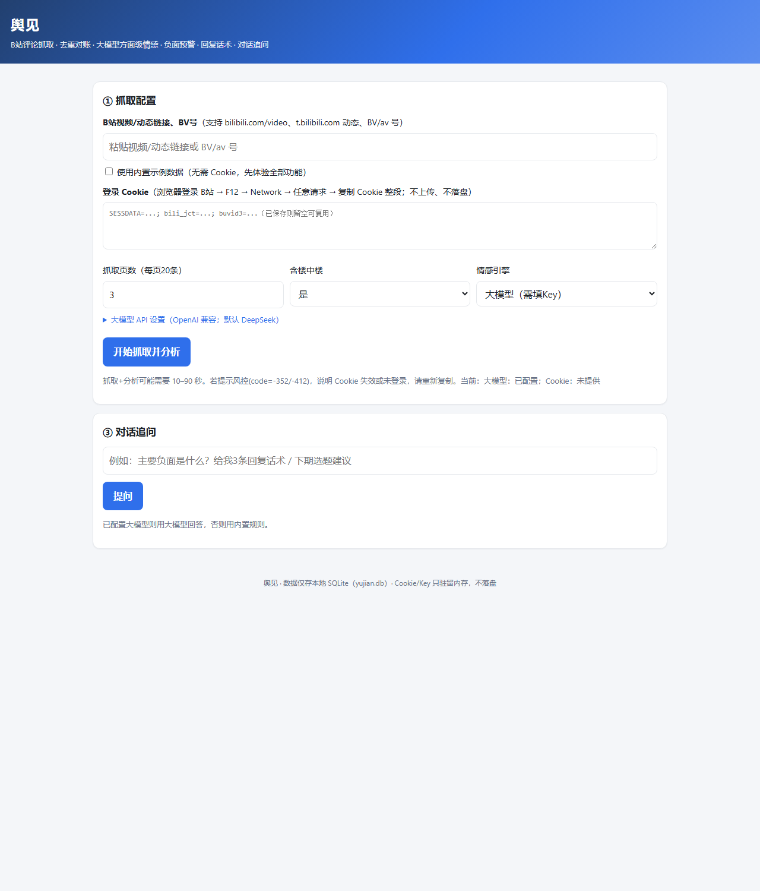
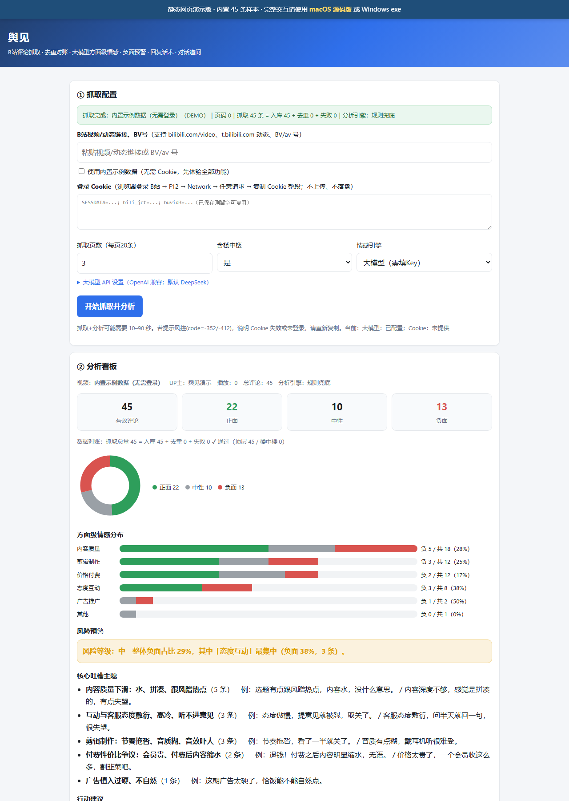
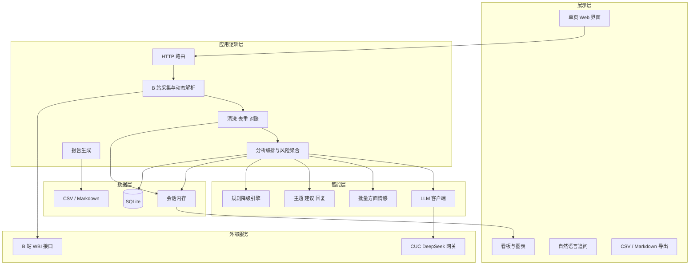

# 舆见 · B站评论区舆情洞察助手

GitHub: https://github.com/ling113312/yujian-bilibili-insight

「舆见」是一个面向中小 B 站创作者的本地评论分析工具：粘贴一条视频、动态或 BV 号，自动采集公开评论，完成清洗去重、方面级情感分析、风险研判、回复草稿和下期选题建议。

项目使用 Python 标准库实现，不依赖 Gradio、Flask、FastAPI、pandas 等第三方运行时；可打包为 Windows 单文件 exe，也支持无网络、无 API Key 的演示模式。



## 核心能力

- 采集 B 站视频、动态、BV/av 号评论，可选 Cookie、分页与楼中楼
- 清洗、去重与强制对账：`总量 = 入库 + 去重 + 失败`
- LLM 批量方面级情感分析，失败时自动切换规则引擎
- 总体情感、方面分布、风险等级、负面 Top、原声证据
- 对话式追问、回复草稿、改进建议、下期选题
- CSV 与 Markdown 报告导出
- 45 条内置演示数据，断网、无 Key 也能完成全流程
- SQLite 本地存储，Cookie 与 API Key 不写入日志、不打包

## 快速开始

### 方式一：源码运行

要求 Python 3.8+，无需安装第三方依赖。

```bash
python app.py
```

浏览器打开 `http://127.0.0.1:7860`。端口被占用时程序会自动尝试 7861 等后续端口。

### 方式二：Windows exe

在课程交付包中双击 `舆见.exe`。首次运行如遇 SmartScreen 或杀软提示，选择"更多信息 → 仍要运行"。

### 演示模式

在页面勾选"使用演示数据（无需 Cookie、无需 Key）"，点击开始即可使用 45 条内置评论完成全流程。演示模式适合课堂展示和网络异常时的兜底。

### macOS / 无 Python 环境

- 只想快速展示界面：直接打开 [静态网页演示版](docs/网页演示版.html)，无需安装 Python。
- 需要完整交互：在 macOS 上安装 Python 3.9+，双击 `run.command`（见 [macOS 使用说明](docs/MACOS.md)）。
- Windows exe 不能在 macOS 上运行；macOS 使用源码版或静态演示版。



## 配置大模型

复制配置模板并填入自己的 API Key：

```bash
copy config.example.json config.json
```

`config.json` 示例：

```json
{
  "base": "https://openai.cuc.edu.cn/v1/chat/completions",
  "model": "cuc/deepseek",
  "key": "你的 API Key"
}
```

也可以在页面展开"大模型配置"临时填写 API Key、Base URL 和模型名，或使用环境变量 `LLM_BASE`、`LLM_MODEL`、`DEEPSEEK_API_KEY`。

未配置 Key 时自动使用规则分析，不会阻塞演示。

## 测试

```bash
python tests/smoke_test.py
```

该脚本会启动一个临时端口，访问 `/api/health`，以演示模式执行一次 `/analyze`，并检查页面是否返回正面、中性、负面结果。

更完整的验收记录见 [产品设计说明书](docs/产品设计说明书.pdf) 第 6 章。

## 项目结构

```text
yujian-github/
├─ app.py                  # 单文件应用：采集、对账、分析、看板、导出
├─ config.example.json     # 大模型配置模板，不含真实 Key
├─ run.bat                 # Windows 源码启动脚本\n├─ run.command             # macOS 源码启动脚本
├─ requirements.txt        # 仅标准库，无第三方运行时依赖
├─ docs/
│  ├─ 产品设计说明书.pdf
│  ├─ 使用说明.md
│  ├─ ARCHITECTURE.md
│  ├─ TESTING.md
│  └─ PRIVACY.md
├─ tests/
│  └─ smoke_test.py
├─ assets/
│  └─ screenshot-home.png
├─ .gitignore
├─ LICENSE
└─ README.md
```

## 系统架构



## 设计取舍

- **单视频粒度**：不追求全网监测，只围绕一条视频的评论区做完整分析。
- **统计与语义分开**：总数、比例、对账由确定性代码计算，LLM 只做情感判断和文字生成。
- **本地优先**：标准库 + SQLite + 单文件 exe，教师端无需安装 Python。
- **可降级**：无 Key、断网、LLM 超时都能回落到规则分析，并明确标注。

## 已知边界

- V1.0 只支持 B 站，不覆盖微博、小红书、抖音。
- 情感与方面判断仍可能受口语、反讽、圈层梗影响。
- 单机版适合 1 至 10 人低并发，不面向多用户 SaaS。
- 方面情感人工抽查、手机端真机测试、万级评论压力测试仍需继续补充。

## 合规与隐私

本项目只处理公开视频与公开评论，不绕过登录、验证码或访问控制；Cookie 与 API Key 只保存在本地；页面展示作者标识时做脱敏处理；删除 `yujian.db` 即可清空历史数据。详见 [PRIVACY.md](docs/PRIVACY.md)。

## License

MIT License，详见 [LICENSE](LICENSE)。


