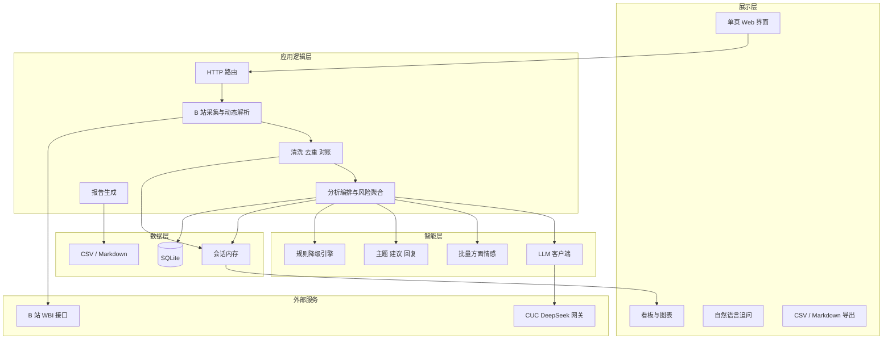

# 系统架构

「舆见」采用五层结构，核心原则是"统计走代码、语义走模型、失败可降级"。

## 主链路

1. 用户输入视频链接、动态链接或 BV/av 号。
2. `extract_bvid` 提取标识；动态链接由 `resolve_dynamic` 解析到关联视频。
3. `fetch_bili_comments` 使用 WBI 签名、UA、Referer 和可选 Cookie 分页采集。
4. `clean_and_dedup` 去 HTML、空白、零宽字符，按 rpid 与文本哈希去重。
5. `analyze_comments` 按 15 条一批、4 线程调用 LLM；失败批次回落规则。
6. `aggregate` 与 `compute_risk` 只做确定性统计，不让模型直接算总数。
7. `save_to_db` 写入 SQLite，页面渲染看板、证据、建议与追问入口。

## 关键约束

- 总量 = 入库 + 去重 + 失败。
- 正面 + 中性 + 负面 = 分析总数。
- LLM 失败时规则引擎接管，页面标注"规则降级"。
- Cookie 与 API Key 只保存在本地，不写入日志、不打包。

## 代码入口

- `app.py`：单文件应用，包含采集、清洗、分析、聚合、页面渲染、导出与 HTTP 服务。
- `tests/smoke_test.py`：启动临时端口，验证健康接口和演示模式全流程。

